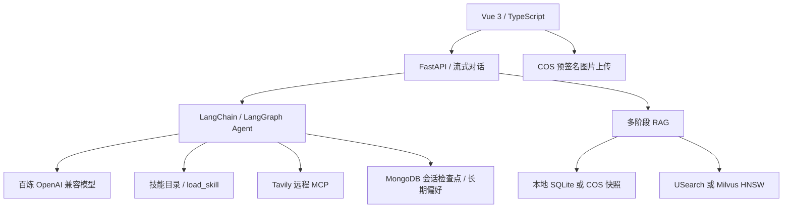

# Nutrition Chef · AI 私人营养师

基于 **Vue 3 + FastAPI + LangChain/LangGraph** 的饮食助手。支持根据文字食材或食材图片推荐菜谱，结合营养知识库与联网搜索提供来源，并按用户需求生成多日菜单、采购清单和备餐安排。

项目整合了多阶段 RAG、Milvus HNSW、MCP 工具调用、按需加载的 Agent Skills、会话摘要和跨会话饮食偏好。当前适用于本地开发与技术学习，尚未实现账号登录和生产环境访问控制。

本文是项目唯一的介绍和使用文档，包含环境准备、启动、配置、实现细节与上传说明。`skills/*/SKILL.md` 是 Agent 运行时加载的技能文件，知识库中的 Markdown 是检索资料，均按功能保留。

## 功能

- **食材与菜谱问答**：文字输入、流式回答；配置支持视觉的模型及 COS 后可上传图片。
- **RAG 知识库**：导入 Markdown、TXT、带文字层的 PDF，返回带文件名、页码及来源的参考资料。
- **混合检索**：多 query 改写、BM25 与向量召回、RRF 融合、子块重排、同父块邻近片段扩展、原文抽取压缩。
- **向量搜索**：本地 USearch HNSW 或独立 Milvus HNSW，可配置切换。
- **联网搜索**：通过 Tavily 官方远程 MCP 服务发现并调用搜索工具。
- **Agent Skills**：按需加载菜谱推荐和多日备餐的 `SKILL.md`，避免把所有流程常驻上下文。
- **上下文管理**：近期对话、历史摘要、工具结果精简与请求预算管理；完整会话由 MongoDB 检查点保存。
- **长期偏好**：用户明确要求后保存过敏、忌口、喜好、目标等信息；支持页面查看、修改与清空。
- **知识库更新**：可监听本地完整资料目录，生成新快照、同步 Milvus，验证成功后再切换；失败保留旧版本。

## 架构与关键技术



| 技术 | 项目中的用途 |
| --- | --- |
| Vue 3、TypeScript、Vite、Axios | 聊天界面、流式消息、图片上传与长期偏好面板 |
| FastAPI、Pydantic | API、输入校验和生命周期管理 |
| LangChain、LangGraph | Agent 工具调用、动态提示词、运行上下文与检查点 |
| 百炼 OpenAI 兼容接口 | 聊天、可选视觉理解、Embedding、查询改写及相关性重排 |
| BM25、RRF、抽取压缩 | 关键词与语义结果融合，并控制参考上下文长度 |
| Milvus / USearch HNSW | 近似最近邻向量检索 |
| MongoDB | 会话历史、摘要检查点、长期用户档案及会话归属 |
| 腾讯云 COS | 图片、原始知识库资料与版本化快照 |
| MCP、langchain-mcp-adapters | 通过统一工具协议连接 Tavily 搜索服务 |
| Agent Skills | 用 `SKILL.md` 封装可按需加载的任务流程 |

RAG 实际顺序：

```text
原问题＋近期对话/摘要/已保存偏好
  → 多 query 改写（保留原问题）
  → BM25＋向量召回 → RRF 融合
  → 对子 chunk 重排筛选
  → 同 parent 下批量扩展邻近 chunk
  → 原文抽取压缩 → 作为参考送入 Agent
```

**存储职责不同**：MongoDB 管会话和偏好；COS/SQLite 管知识库快照；Milvus 管向量及 HNSW 检索数据。当前后端仍加载知识库快照来执行 BM25、邻块扩展和来源关联，没有将全部知识库查询迁入 Milvus。

## 目录

```text
.
├─ dietitian/                  Python 后端
│  ├─ agents/                  Agent、上下文、记忆、MCP 与技能加载
│  ├─ api/                     对话、上传、知识库与长期偏好 API
│  ├─ rag/                     分块、检索、向量索引、快照与自动更新
│  ├─ skills/*/SKILL.md         项目技能
│  ├─ knowledge/examples/      可公开的虚构演示资料
│  ├─ knowledge/documents/     本地知识库原始资料（不提交）
│  ├─ tests/                   后端测试
│  ├─ .env.example             无真实密钥的配置模板
│  └─ pyproject.toml / uv.lock  Python 依赖与锁文件
├─ dietitian-ui/               Vue 前端
├─ tools/check_public_files.py  上传前文件检查
├─ docker-compose.milvus.yml    本地 Milvus / etcd / MinIO
├─ start-project.ps1            已准备好环境后的 Windows 启动脚本
└─ .runtime/                   本机数据、日志、索引和进程 ID（不提交）
```

## 首次启动（Windows PowerShell）

下面从干净克隆开始，不依赖作者电脑中的虚拟环境、数据库或云端知识库。所有命令中的占位内容均需替换；不要覆盖已有 `.env` 或知识库。

### 1. 准备环境

- Git。
- Python：项目声明 `>=3.11`，当前 Windows 开发环境验证版本为 **3.13**。
- Node.js 与 pnpm：当前前端开发环境验证版本为 **Node.js 24**。
- MongoDB：先准备一个可连接的实例；下面给出本机 Docker 示例。
- 使用 Milvus 或 Docker MongoDB 时需要 Docker Desktop 及 Docker Compose。
- 自己的百炼 API Key 与可用模型 ID；联网搜索需 Tavily API Key，图片/COS 知识库需自己的 COS 配置。

### 2. 安装依赖

在项目根目录打开 PowerShell：

```powershell
cd dietitian
python -m venv .venv-win
.\.venv-win\Scripts\python.exe -m pip install uv
$env:UV_PROJECT_ENVIRONMENT = (Resolve-Path .venv-win).Path
.\.venv-win\Scripts\uv.exe sync --locked
Copy-Item .env.example .env
cd ..\dietitian-ui
pnpm.cmd install --frozen-lockfile
cd ..
```

`UV_PROJECT_ENVIRONMENT` 确保依赖装入启动脚本使用的 `.venv-win`，不会另建默认 `.venv`。无需激活虚拟环境即可使用文档中的 Python 命令。

### 3. 填写本地配置

编辑 `dietitian/.env`，至少填写聊天模型配置：

```dotenv
DASHSCOPE_BASE_URL=你的百炼OpenAI兼容接口地址
DASHSCOPE_API_KEY=仅在本地填写
DASHSCOPE_MODEL=你的账户已开通的模型ID
MONGODB_URI=mongodb://localhost:27017
```

接口地域、密钥和模型必须匹配；不要直接照抄他人模型 ID。图片输入还要求模型支持视觉。聊天模型与 Embedding 模型是独立配置，`text-embedding-v4` 也需要相应权限与额度。

搜索配置：`TAVILY_API_KEY`；兼容历史拼写 `TVILY_API_KEY`。默认 MCP 地址是 `https://mcp.tavily.com/mcp/`，无需本机部署 Tavily 服务。密钥通过请求头传递。

模板默认 `RAG_STORAGE=local`、`RAG_VECTOR_BACKEND=usearch`、`RAG_AUTO_UPDATE=false`，可以先跑通本地流程。COS、Milvus 和自动同步按需启用；当前电脑的私有 `.env` 可能与模板不同。

### 4. 启动 MongoDB

已有 MongoDB 可直接使用。若本机 27017 端口空闲，也可用独立开发容器：

```powershell
docker run -d --name nutrition-chef-mongo --restart unless-stopped -p 127.0.0.1:27017:27017 -v nutrition-chef-mongo-data:/data/db mongo:8.0
```

该容器和命名卷会留在本机。以后启动已有容器使用 `docker start nutrition-chef-mongo`，不要重复创建。此示例只绑定回环地址，未配置数据库鉴权，仅用于本地开发。

### 5. 准备演示知识库

仓库默认不包含你的原始知识库、聊天记录和生成索引。先复制公开示例，再构建纯关键词索引验证流程：

```powershell
cd dietitian
New-Item -ItemType Directory -Force knowledge/documents
Copy-Item knowledge/examples/documents/demo_recipe.md knowledge/documents/demo_recipe.md
Copy-Item knowledge/examples/sources.example.json knowledge/sources.json
.\.venv-win\Scripts\python.exe -m rag build --lexical-only
.\.venv-win\Scripts\python.exe -m rag status
cd ..
```

首次演示请保持 `RAG_AUTO_UPDATE=false`。`--lexical-only` 仅表示建索引不调用 Embedding，**问答仍会调用聊天模型，改写和重排也可能产生模型调用**。

有可用 Embedding 配置后，运行 `python -m rag build` 生成向量，启用完整混合检索。使用上述虚拟环境的完整 Python 路径执行即可。

### 6. 启动后端和前端

终端一：

```powershell
cd dietitian
.\.venv-win\Scripts\python.exe -m uvicorn main:app --host 127.0.0.1 --port 8001
```

终端二：

```powershell
cd dietitian-ui
pnpm.cmd dev --host 127.0.0.1 --port 5173 --strictPort
```

- 前端：<http://127.0.0.1:5173/>
- API 文档：<http://127.0.0.1:8001/docs>
- 知识库状态：<http://127.0.0.1:8001/dietitian/api/knowledge/status>

Vite 已将 `/dietitian/api` 代理到后端 8001。手动运行时按 `Ctrl+C` 停止各终端的服务。

### 7. 可选：Windows 一键启动

依赖和配置准备完成、MongoDB 已启动后，在根目录运行：

```powershell
powershell -NoProfile -ExecutionPolicy Bypass -File .\start-project.ps1
```

此脚本使用 `dietitian/.venv-win`，默认前端端口 **80**、后端 **8001**，后台运行并将日志/PID 写入 `.runtime`。它不是安装器；如果 MongoDB 未监听，会查找 `.runtime/mongodb/server` 下的 `mongod.exe`，新克隆中没有这个本地安装包，因此应先按前文启动 MongoDB。脚本还要求聊天和 Tavily 配置非空；缺少时跳过后端。

当配置选择本机 Milvus 且端口未监听时，脚本会启动项目的 Milvus Compose。端口已被占用时脚本会跳过对应服务，不核实该端口是否属于本项目。**修改代码或 `.env` 后需重启后端；重复执行脚本不会自动重启正在运行的后端。**

## 可选组件

### Milvus HNSW

在根目录启动：

```powershell
docker compose -f docker-compose.milvus.yml up -d
docker compose -f docker-compose.milvus.yml ps
```

先按本地模式构建包含向量的知识库，再将 `dietitian/milvus.env.example` 中参数合并到私有 `.env`，运行：

```powershell
cd dietitian
.\.venv-win\Scripts\python.exe -m rag sync-milvus
```

同步成功后使用 `RAG_VECTOR_BACKEND=milvus` 并重启后端。同步只导入已有向量，不重新调用 Embedding；纯关键词索引不能同步成 HNSW。配置文件采用本地开发默认内部凭证，仅绑定本机服务端口，不用于直接公网部署。

Milvus、etcd、MinIO 分别有 Docker 命名卷。普通 `docker compose down` 保留卷；`down -v` 会删除数据，停止服务时不要附加 `-v`。

### 图片上传与 COS 知识库

图片上传需要 `COS_SECRET_ID`、`COS_SECRET_KEY`、`COS_APP_ID`、`COS_BUCKET`、`COS_REGION`。后端签发短期上传 URL，浏览器上传到 COS；桶需允许前端来源的跨域 PUT，图片读取方式也需与模型访问能力匹配。不要把云密钥放入前端 `VITE_*` 变量。

知识库首次发布前保持本地模式，配置自己的 COS 后执行：

```powershell
cd dietitian
.\.venv-win\Scripts\python.exe -m rag publish knowledge/documents --sources knowledge/sources.json
```

验证发布与检索后设置 `RAG_STORAGE=cos`。开启 `RAG_AUTO_UPDATE=true` 后会监听模板指定目录，文件连续两次稳定检测后发布；此目录表示**完整资料集**，不是只放新增文件的增量目录。构建会产生 Embedding 等费用。

## 实现细节与扩展

### RAG 分块、检索与压缩

实现入口：[store.py](dietitian/rag/store.py)、[pipeline.py](dietitian/rag/pipeline.py)。

普通资料先按最多1800字符、重叠200字符建立父块，再按400字符、重叠60字符建立子块。`recipes/` 下不超过10000字符的菜谱可整体作为父资料；PDF 保留页码。父子关系随快照保存，旧版无 `parent_id` 索引仍兼容，但重建后才能获得显式父子边界。这些长度单位均为字符，不是 token。

检索改写结合近期对话、已有摘要与长期偏好，总计最多6条背景。保留用户原始问题，生成少量互补 query，避免改写丢失否定、过敏或数量条件。每条 query 分别检索 BM25 与向量索引，按名次使用 RRF 融合，不直接相加不同量纲的相似度分数。

模型重排只接收候选子块的标题与正文，对每个候选输出相关性分数；分数不是事实可信度或医学可靠度。先过滤并保留子块，再在同文件、同页、同 parent 内取邻近 chunk，合并重叠窗口。不会将整篇父文档送给重排模型。

压缩按原文句子/行抽取，保留片段顺序和字符偏移，不生成新的摘要。窗口不完整或进一步删减时标记 `compressed` / `partial_parent`，不能据此声称读到完整菜谱。抽取仍可能遗漏远处的限定条件。

常用可选配置（写入私有 `.env`，重启后端）：

| 配置 | 默认值 | 用途 |
| --- | --- | --- |
| `RAG_QUERY_REWRITE` / `RAG_RERANK` | `true` | 是否调用模型改写/重排 |
| `RAG_MAX_QUERIES` | `3` | 包含原问题的查询上限 |
| `RAG_FETCH_K` | `20` | 召回候选数 |
| `RAG_RERANK_TOP_K` | `8` | 筛选后保留的种子子块上限 |
| `RAG_NEIGHBOR_RADIUS` | `1` | 同 parent 下前后邻块数；0表示仅命中块 |
| `RAG_PARENT_K` | `12` | 候选上下文窗口数上限，保留历史参数名 |
| `RAG_MIN_SIMILARITY` / `RAG_MIN_RELEVANCE` | `0.35` / `0.2` | 向量相似度与重排相关性阈值 |
| `RAG_CONTEXT_CHARS` / `RAG_DOCUMENT_CHARS` | `6000` / `2500` | 资料总正文与单窗口正文上限 |

Embedding 默认 `text-embedding-v4`，可使用独立的 `RAG_EMBEDDING_API_KEY` / `RAG_EMBEDDING_BASE_URL`。更换模型或向量维度后需要重建。改写/重排默认使用聊天模型，也可分别指定 `RAG_REWRITE_MODEL`、`RAG_RERANK_MODEL`，以及共同使用的 `RAG_PIPELINE_API_KEY` / `RAG_PIPELINE_BASE_URL`。模型阶段均会增加费用和等待时间。

改写失败使用原问题；向量失败降级 BM25；重排失败使用 RRF 排序。返回 `warning`，不会伪装成各阶段全部成功。实际检索可从 `trace.queries`、`vector_backend`、`children_kept`、`rerank`、`context_chars` 及命中片段的来源信息观察。

### HNSW 与向量持久化

实现入口：[ann.py](dietitian/rag/ann.py)、[milvus_index.py](dietitian/rag/milvus_index.py)。

USearch 在进程内从快照已有向量建图并缓存，后端重启或快照变化后重新建立；没有独立持久化 HNSW 图文件。Milvus 在独立服务中构建并持久化图，通过稳定 `chunk_id` 将搜索结果关联回当前快照；集合保存 `chunk_id`、`vector` 和子块 `payload`。

Milvus 同步先创建候选集合、插入、flush、建立 HNSW COSINE 索引并检查行数，再发布对应指纹别名。指纹关联快照和建图参数，避免不完整集合用于查询；重复同步可复用已验证集合。正常查询不会隐式上传向量或建图，失败时降级 BM25，不自动切换另一个向量后端。

`RAG_HNSW_M=16` 控制连接数，`RAG_HNSW_EF_CONSTRUCTION=200` 控制建图搜索宽度，`RAG_HNSW_EF_SEARCH=256` 控制查询宽度。调整 M / 建图宽度需重新准备索引，查询宽度无需重新导入。增大搜索宽度通常提高召回，也增加成本；ANN 可能漏召回，重排无法补回未召回资料。USearch 使用 `1-distance` 转换相似度，Milvus COSINE 返回分数直接作为相似度使用。

### 知识库资料、快照与自动更新

实现入口：[cos_storage.py](dietitian/rag/cos_storage.py)、[auto_update.py](dietitian/rag/auto_update.py)。

本地模式从 `knowledge/documents` 和可选 `knowledge/sources.json` 构建 `.runtime/rag/knowledge.sqlite3`。来源清单按相对文件名登记标题、原始链接、机构和核验时间；扫描 PDF 需先 OCR。知识库原始资料与来源清单默认不提交 Git，公开示例仅用于验证程序，不能代替营养指南。

选用公开营养资料时保留机构、发布时间、适用人群与原始链接；英文资料可用中文解释。旧食谱不等同于当前临床指南，美国营养标签值不等同于中国标准，替换食材后不能照搬原方营养数值。导入和再分发资料需分别核对来源要求。

COS 以 `RAG_COS_PREFIX` 为根前缀（默认 `knowledge/nutrition`）保存：

```text
datasets/<dataset_id>/documents/  原始资料
datasets/<dataset_id>/manifest.json
indexes/<version>.json           文本、向量与元数据快照
current.json                     当前版本指针和校验值
```

原始资料、分块、向量和来源冻结到同一版本，查询不必重复解析 PDF 和调用 Embedding。后端读取小型版本指针，未变化时复用内存缓存，变化后下载并校验新快照；部分较大对象采用 gzip 传输。COS 读取失败不会悄悄读取另一份本地库。

发布先上传并校验资料集、构建候选快照，再同步所选 Milvus 索引，最后切换指针；任一步失败保留旧活动版本。COS 原始资料与快照采用私有对象 ACL，仍需正确配置桶策略与最小权限。`RAG_COS_BUCKET` 可选择独立桶，`COS_SESSION_TOKEN` 可配置知识库存储临时凭证。

在 `dietitian` 目录使用虚拟环境执行：

```powershell
# 本地构建 / COS当前资料集重建，取决于RAG_STORAGE
.\.venv-win\Scripts\python.exe -m rag build
.\.venv-win\Scripts\python.exe -m rag status
.\.venv-win\Scripts\python.exe -m rag search "豆腐和西兰花怎么做？"
# 发布完整资料集；--stage仅构建候选，不激活
.\.venv-win\Scripts\python.exe -m rag publish knowledge/documents --sources knowledge/sources.json --stage
.\.venv-win\Scripts\python.exe -m rag versions
# 将占位内容替换成实际版本；既可回滚，也可激活已验证候选
.\.venv-win\Scripts\python.exe -m rag rollback <version>
```

`publish`、COS 重建及回滚激活会先准备对应 Milvus 集合；本地重建也会在替换 SQLite 前同步所选 Milvus。`--stage` 不同步或激活，`sync-milvus` 可用于修复已有快照索引或调整建图参数。历史快照与候选集合没有自动清理机制。

自动更新使用内容 SHA-256 与来源元数据，每5秒检查一次，连续两次变更相同后开始构建；不是5秒内保证完成。默认失败30秒后重试；构建中再次修改文件时不激活过时候选。删除部分文件会在成功后移除对应记录，目录为空或不可读则报错并保留旧版本。监听只随后端运行，停机修改在下次启动检测。

`RAG_WATCH_DIRECTORY`、`RAG_WATCH_SOURCES` 的相对路径以 `dietitian` 为根。`/dietitian/api/knowledge/status` 中的 `auto_update.phase` 可查看等待稳定、构建、同步或错误状态。监听目录是权威完整来源，另行发布其他目录可能被下一次监听覆盖。当前仅有进程内锁和激活前版本检查，多实例应仅保留一个发布者，不具备分布式更新锁。

### Tavily MCP 联网搜索

实现入口：[tavily_mcp.py](dietitian/agents/tavily_mcp.py)。

```text
Agent调用web_search(query)
  → MultiServerMCPClient（Streamable HTTP）
  → tools/list发现Tavily搜索工具
  → tools/call执行搜索
  → 整理标题、来源、摘要和图片 → Agent回答
```

Agent 看到固定的 `web_search` 入口，内部通过 MCP 调用远程搜索工具，只选择搜索能力，不自动开放抓取和爬虫工具。首次实际搜索时发现并缓存工具定义，不缓存搜索结果；每次调用由适配器建立和结束相应 MCP 会话。

`TAVILY_MCP_TIMEOUT` 默认30秒。查询最多1000字符，保留最多5条结果与5张图片，每条结果正文最多2000字符。凭证通过 `Authorization` 请求头传递，不拼入 URL；报错只记录异常类型。连接失败清除发现缓存，下次可重新发现；工具返回明确失败结果，不回退直接 Tavily SDK，也不能声称已经联网搜到资料。搜索仍消耗 Tavily 账户额度。

### Agent Skills

实现入口：[skills.py](dietitian/agents/skills.py)。内置 `recipe-recommendation`（菜谱推荐、评分、做法）和 `weekly-meal-prep`（多日菜单、采购、备餐）。

每轮创建独立 `loaded_skills={}`。模型先看到名称与用途，再调用 `load_skill(name)` 从项目固定目录读取正文；下一次模型请求将完整流程加入动态系统提示。工具只返回加载确认，避免重复发送全文。下一轮重新选择，历史工具确认不代表技能仍已加载。技能正文纳入整体上下文预算，不作为长期用户偏好保存。

添加技能可在 `dietitian/skills/<技能名>/SKILL.md` 创建：

```markdown
---
name: ingredient-substitution
description: 当用户缺少菜谱食材时，提供符合用途与饮食限制的替换方案。
---

# 食材替换
确认原食材在菜谱中的作用，结合过敏、忌口与烹饪方式给出替换。
说明用量和营养变化；缺少依据时不声称完全等价。
```

名称使用小写字母、数字和连字符，最长64字符，与文件夹同名；描述最多1024字符，正文最多6000字符，文件最多24000字节。最多20个技能，本轮正文合计最多10000字符。新增或修改名称/描述后重启后端；正文在下一次加载时读取最新文件。

目前不执行技能脚本、不开放任意文件路径读取，也不提供 references/assets 独立读取工具。仅项目维护者编辑技能目录。技能选择依赖模型遵循指令，不是硬性调度器；技能描述流程，MCP 连接外部能力，RAG 提供参考资料。

### 短期对话与上下文预算

实现入口：[context.py](dietitian/agents/context.py)、[conversation.ts](dietitian-ui/src/utils/conversation.ts)。

`thread_id` 为随机 UUID，保存在标签页 `sessionStorage`；刷新可继续，新对话创建新 ID，不删除旧数据库记录。清空记录删除当前会话检查点与摘要后创建新 ID；当前没有历史会话列表。复制标签页可能复制会话标识，需要新建对话明确区分。发送时限制重复操作和会话切换。

MongoDB 保留完整用户、助手和工具消息。模型输入由 `ConversationContextMiddleware` 整理：达到约6000估算 token 或24条消息时，保留最近4个用户轮次，把更早的用户/助手文本分批合并为摘要。摘要用稳定消息 ID 标记覆盖边界，不重复摘要已覆盖历史，也不把图片和工具全文送入摘要模型。

摘要采用独立客户端，不流入回答；失败不删除记录、不推进边界。历史图片和工具结果只在模型请求副本中简化，当前图片保留，工具调用与结果保持配对。预算不足时按完整用户轮次舍弃旧输入，再精简工具正文，仍超出则提示缩短输入，不静默截断当前用户要求。

默认配置：

```dotenv
CHAT_CONTEXT_TOKENS=32000
CHAT_OUTPUT_TOKENS=4096
CHAT_SUMMARY_TRIGGER_TOKENS=6000
CHAT_SUMMARY_TRIGGER_MESSAGES=24
CHAT_KEEP_RECENT_TURNS=4
CHAT_SUMMARY_CHARS=2400
CHAT_TOOL_RESULT_CHARS=4000
CHAT_IMAGE_TOKEN_RESERVE=2048
```

可用 `CHAT_SUMMARY_MODEL` / `CHAT_SUMMARY_API_KEY` / `CHAT_SUMMARY_BASE_URL` 指定摘要模型，默认沿用聊天配置。总体预算包含系统提示、RAG、技能、摘要、工具定义、消息及图片预留。token 采用保守估算，不是模型官方 tokenizer；摘要与抽取可能丢失信息，重要限制仍应由用户确认。单次输入限制8000字符、4张图片；MongoDB 完整历史无自动归档或 TTL。

### 长期跨会话记忆

实现入口：[memory.py](dietitian/agents/memory.py)、[memory API](dietitian/api/memory.py)。

页面“长期记忆”可管理过敏、忌口、喜好、饮食方式、目标、预算，也可明确说“请记住我喜欢西兰花”或“请忘记我的某项偏好”。只有本轮用户明确请求且字段有原话支持时，记忆工具才允许写入；普通提问、知识库、图片和助手建议不能授权保存。工具成功后才能声称已记住或忘记，复杂表达可改用面板填写。

`user_id` 是保存在 `localStorage` 的随机 UUID，跨会话使用；不同浏览器/设备默认不是同一用户，清除存储会丢失关联，服务器档案不会因此自动删除。随机 ID 不是账号认证；已有会话归属校验，但仍不能替代登录系统。

MongoDB 默认数据库 `dietitian`（可用 `USER_MEMORY_DATABASE` 修改），`user_memories` 保存结构化 `facts`、修改 `revision` 与时间；`conversation_owners` 保存会话归属。列表最多12项、每项60字符，饮食方式与预算各80字符。档案直接按用户 ID 查询，不使用 Embedding。

表单保存采用 revision 乐观并发控制，旧版本返回409，不能覆盖新版本；聊天工具更新列表时追加去重。删除后保留空字段和递增版本，防止已发出的旧表单恢复被删除内容。每轮读取最新偏好，作为 JSON 背景加入动态提示与检索背景；同轮修改成功后即时更新运行上下文。

接口均位于 `/dietitian/api`：

| 接口 | 用途 |
| --- | --- |
| `GET /memory/profile` | 读取档案、revision和时间 |
| `PUT /memory/profile` | 提交 `facts` 与当前 `revision` |
| `DELETE /memory/profile` | 清空长期偏好 |

这些接口携带 `X-User-Id`，聊天请求使用 `user_id`，前端已处理；身份头不发送到 COS 上传接口。清空聊天保留长期档案，清空长期档案不删除旧聊天、COS 或 Milvus；旧聊天仍可能包含已忘记的信息，需另外清空相关会话。当前档案不会从旧摘要自动恢复。

## 测试与构建

```powershell
# 根目录：检查 Git 将收录的文件（不显示密钥值）
.\dietitian\.venv-win\Scripts\python.exe -X utf8 tools/check_public_files.py

# 后端
cd dietitian
.\.venv-win\Scripts\python.exe -m unittest discover -s tests -q

# 前端
cd ..\dietitian-ui
node --experimental-strip-types --test tests/conversation.test.mjs tests/user.test.mjs
pnpm.cmd build
```

## 上传 GitHub 前

根目录 `.gitignore` 已排除 `.env`、虚拟环境、依赖目录、运行日志、数据库、上传文件、IDE 状态，以及 `knowledge/documents` 和私有 `sources.json`。只提交不含真实值的 `.env.example` 与公开演示资料。

不要直接压缩整个项目目录上传，也不要使用 `git add -f` 绕过忽略规则。`.gitignore` 只控制未跟踪文件，**无法从历史提交或已暂存内容中移除密钥**。

新仓库可以先在本机准备提交，检查后再推送：

```powershell
git init
git branch -M main
git add .
.\dietitian\.venv-win\Scripts\python.exe -X utf8 tools/check_public_files.py
git status --short
git diff --cached --stat
git diff --cached
```

检查暂存内容中的密钥、云账号/桶名、姓名邮箱、私人文件、图片及资料版权。确认无误后：

```powershell
git commit -m "Initial project"
git remote add origin https://github.com/<你的GitHub用户名>/<仓库名>.git
git push -u origin main
```

检查脚本提供本地凭证值与常见敏感模式检测，不能保证识别所有隐私，也不检查完整历史和图片内容。若密钥曾进入提交、公开链接或他人可访问的日志，应先在服务商控制台撤销并重建，再清理仓库历史；只删文件或改成私有仓库不能使已泄露密钥失效。

GitHub 仓库不应包含自己的 COS 数据、MongoDB 备份或用户档案。运行时，图片/命中资料/对话可能发送到你配置的模型、搜索和存储服务；这与“代码仓库未泄露”是不同边界。当前 API、CORS、上传签名与浏览器身份机制面向本地开发，公开部署前需补齐认证、访问控制及费用限制。

## 常见问题

| 现象 | 检查内容 |
| --- | --- |
| 模型不可用 | 模型 ID、地域、Key、账户权限与额度；修改 `.env` 后重启 |
| 知识库无内容 | 新克隆不带私人资料和快照，先复制示例并构建 |
| Milvus 无向量结果 | 服务健康、已构建向量、执行过 `sync-milvus`、配置与快照一致 |
| 图片上传失败 | COS 配置、跨域 PUT、桶权限及模型能否读取图片 |
| 页面能打开但对话失败 | MongoDB 与后端 8001 是否启动、Vite 代理及后端错误日志 |
| 一键脚本找不到 MongoDB | 先启动独立 MongoDB；`.runtime` 安装包不会随 GitHub 分发 |

## 资料与许可

项目介绍、启动和技术说明统一维护在本文。知识库 Markdown 和技能 `SKILL.md` 分别用于检索与运行时加载，不属于分散的项目说明文档。公开资料的引用与再分发需分别遵守原来源要求；项目尚未附加开源许可证，不应据此推断已授予第三方内容的再分发权。
